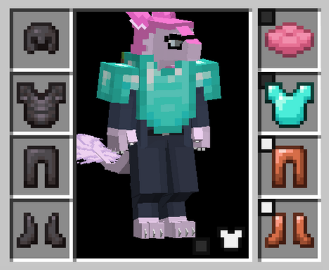
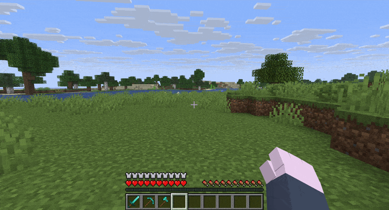
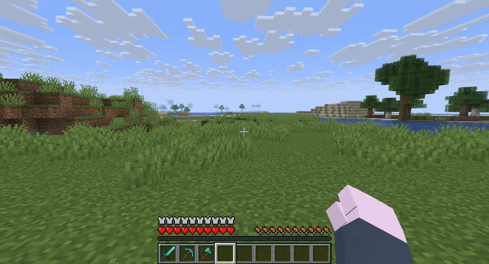

# Cosmetic Armor Next

Source is available on each individual branch, see them here:

| [1.21.6](https://github.com/colduw/CosmeticArmorNext/tree/1.21.6) | [1.21.7](https://github.com/colduw/CosmeticArmorNext/tree/1.21.7) | [1.21.8](https://github.com/colduw/CosmeticArmorNext/tree/1.21.8) | [1.21.9](https://github.com/colduw/CosmeticArmorNext/tree/1.21.9) | [1.21.11](https://github.com/colduw/CosmeticArmorNext/tree/1.21.11) | [26.1](https://github.com/colduw/CosmeticArmorNext/tree/26.1) | [26.2](https://github.com/colduw/CosmeticArmorNext/tree/26.2) | [26.3](https://github.com/colduw/CosmeticArmorNext/tree/26.3) |
| :-: | :-: | :-: | :-: | :-: | :-: | :-: | :-: |

A fork of [Cosmetic Armor Reworked](https://www.curseforge.com/minecraft/mc-mods/cosmetic-armor-reworked) for [NeoForge](https://neoforged.net/), [Forge](https://files.minecraftforge.net/net/minecraftforge/forge) and [Fabric](https://fabricmc.net/). It is almost identical to the original mod, with the only change(s) being compatibility with:

- Minecraft versions above 1.21.5
- [Corpse](https://www.curseforge.com/minecraft/mc-mods/corpse)
- [GraveStone](https://www.curseforge.com/minecraft/mc-mods/gravestone-mod)
- Mods / Resource Packs that change the inventory appearance

Corpse Compatibility:

GraveStone Compatibility:

The original [Cosmetic Armor Reworked](https://www.curseforge.com/minecraft/mc-mods/cosmetic-armor-reworked) is licensed under [MMPL](https://github.com/zlainsama/CosmeticArmorReworked/blob/master/LICENSE.txt). This project is not affiliated with, or endorsed by [LainMI](https://github.com/zlainsama).